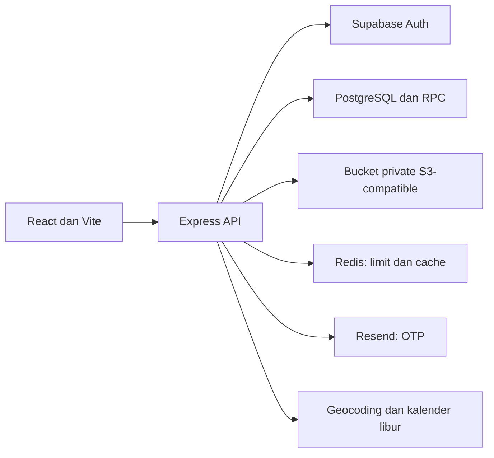
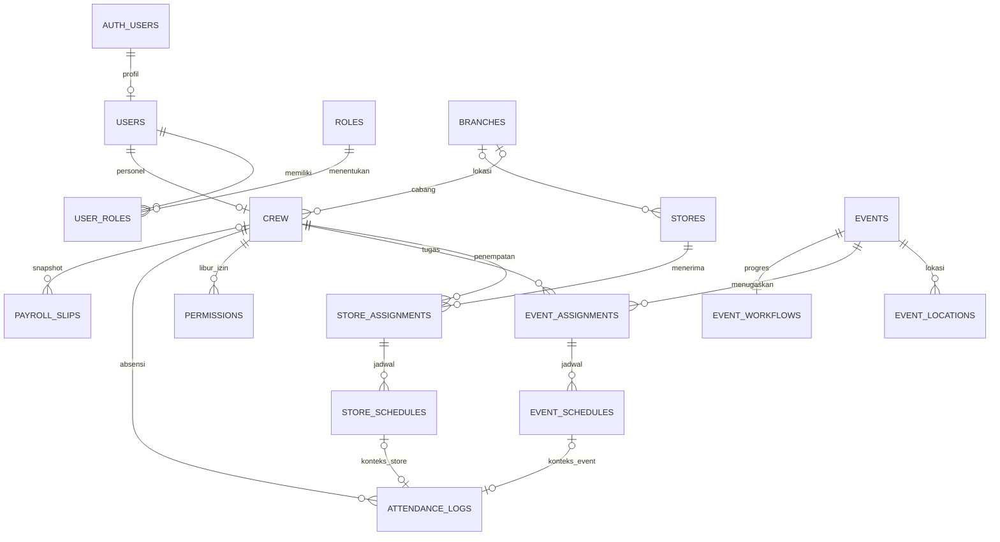

# JAWARA — spesifikasi dan relasi data saat ini

Panduan aktif, 5 Oktober 2026. Baseline implementasi `805c40b`. Menggantikan PRD/ERD v2.0 sebagai ringkasan aplikasi sekarang; bukan usulan membangun ulang.

## Tujuan dan cakupan

JAWARA mengelola personel, penempatan, jadwal, absensi, event dan payroll. Workspace mengikuti role, dengan administrasi global, monitoring kota, operasi event dan pekerjaan pribadi yang berbeda.

Database dipisah per perusahaan. Nama perusahaan/jabatan pada profil adalah informasi bisnis, bukan pemisah tenant. Inventory Bujangan Food tidak aktif pada backend ini; absensi Store tidak berarti seluruh operasional restoran telah diimplementasikan.

## Arsitektur

API bisnis memakai `/api`; `/health` di luar prefix. Sesi frontend berada di memori. Backend memverifikasi pengguna/status/scope walaupun menu sudah dibatasi.

## Role dan aturan utama

Lihat [matriks role](ADMIN_CREW_ACCOUNTS.md). Head Store memonitor kota yang ditugaskan. Event Manager mengelola domain event tanpa akun/payroll global. Staff/crew mengakses pekerjaan dan data pribadi. Super Admin tidak melakukan absensi pribadi; guest mengajukan bukti tanpa akun Auth.

- Jadwal terkait assignment, mendukung tiga label shift dan jam pulang hari berikutnya.
- Rentang dikirim frontend per bulan; hasil membedakan insert, update, konflik dan kunci karena absensi.
- Tanggal merah mengikuti jadwal admin. Libur/izin crew disimpan sebagai pengecualian tanggal; lihat [aturan payroll dan jadwal](PAYROLL_JADWAL.md).
- Absensi terdaftar memakai jadwal, waktu server, lokasi dan foto. Riwayat penempatan serta check-in terbuka harus tetap konsisten saat transfer.
- Guest tersimpan terpisah untuk ditinjau; tidak otomatis menjadi absensi karyawan atau payroll.
- Workflow event menyimpan progress/bukti. Inventory dan Operasional Event membaca hasil workflow tersebut.
- Payroll bulanan/event memiliki aturan/penyesuaian. Aturan tahunan berlaku dari bulan mulai sampai Desember, dengan batas periode dan rencana pembayaran yang dapat diatur. Server menghitung absensi sesuai rentang aktual dan memeriksa periode/event/review sebelum finalisasi. Batas periode dengan slip final/dibayar terkunci.
- Slip Final menyimpan snapshot; Dibayar mencatat pembayaran di luar aplikasi. Slip Dibayar dikunci; membuka Final yang belum dibayar membutuhkan alasan.
- Divisi Finance tidak otomatis memberi izin pengelolaan payroll.
- Auth mengelola password login. Vault salinan terenkripsi khusus Super Admin adalah fitur terpisah.

## Relasi data inti

Diagram ini merangkum relasi utama, bukan dump semua kolom/constraint/policy. Detail tetap mengikuti SQL dan database tujuan.

| Kelompok | Objek utama |
| --- | --- |
| Identitas | `auth.users`, `users`, `roles`, `user_roles`, `crew`, `head_store_scopes`. |
| Direktori/jadwal | `branches`, `stores`, `store_assignments`, `store_schedules`, `national_holidays`, `national_holiday_syncs`. |
| Event | `events`, `event_locations`, `event_assignments`, `event_schedules`, `event_workflows`. |
| Absensi/review | `attendance_logs`, `attendance_corrections`, `permissions`, `overtimes`, `guest_attendances`; objek legacy seperti `guest_attendance_requests` masih dapat ada. |
| Equipment | `equipment_assets`, `event_asset_assignments`, `event_checklists`, `inspection_reports`; keberadaannya tidak menyatakan semua alur legacy teruji end-to-end. |
| Payroll | `payroll_policies` (termasuk batas periode, rencana bayar, tahun aturan), `payroll_adjustments`, `payroll_slips`; RPC `payroll_source`, `payroll_workspace`, `mutate_payroll`, `payroll_year_workspace`, `set_payroll_year_policy`. |
| Pendukung | `audit_logs`, `notifications`, `password_reset_otps` dan vault pada schema private. |

Absensi memakai `store_schedule_id` dan `event_schedule_id` eksplisit, bukan satu FK `schedule_id` generik. Akses service-role tetap membutuhkan pemeriksaan aktor dan role pada backend/RPC.

## Perbedaan dari PRD v2.0

| Desain lama | Implementasi sekarang |
| --- | --- |
| Multi-tenant shared, tenants/user_tenants | Database per perusahaan, users/user_roles. |
| Lima role | Ditambah workspace Head Store, Head Office, staff dan guest. |
| Payroll fase berikutnya | Aturan, penyesuaian dan slip persisted tersedia. |
| Inventory restoran satu backend | Modul Bujangan Food tidak di-mount. |
| Prefix storage tenant | Object key dibentuk backend per jenis bukti. |
| Target face verification | Foto tidak dengan sendirinya menerapkan biometrik. |
| Route tanpa prefix | Bisnis di `/api`, workspace dibatasi, sebagian mutasi legacy dinonaktifkan. |

Arsip v2.0 dipertahankan dalam berkas bernama PDF yang ternyata paket ZIP halaman/teks; lihat [indeks](README.md). Dokumen baru diturunkan dari kode, bukan instruksi SQL dalam arsip.

## Kesiapan

[Laporan 5 Oktober](PROJECT_HANDOVER_20261005.md) mencatat CI browser shift gagal, riwayat payroll perlu dicocokkan, domain OTP belum siap dan warning bundle. Pembaruan dokumentasi tidak memperbaiki kode/konfigurasi tersebut.

Kriteria rilis: tes terkait lulus, scope role teruji, schema tujuan cocok, integrasi storage/email/Redis diperiksa, dan bukti penerimaan tercatat. Ikuti [checklist rilis](RELEASE_CHECKLIST.md).
